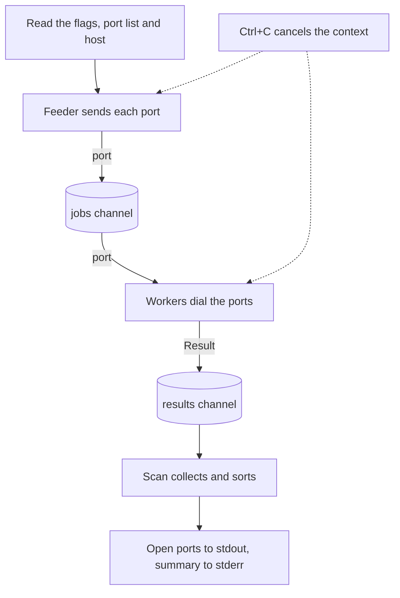

# Port Scanner

A simple project coded in Go to practise understanding it.

It is a small concurrent TCP port scanner. Give it a host and a range of ports, and it tells you which ports accept a connection. The aim is to learn how Go handles goroutines, channels, contexts and tests, so the code carries comments that explain why each piece is there.

## How it works



The feeder, the workers and the collecting loop all run at the same time. The two channels are the pipes between them. A Ctrl+C reaches the feeder and the workers through the context, so the scan stops and the results are marked partial.

## What it does

- Scans a host for open TCP ports, many at once, using a fixed pool of worker goroutines.
- Takes a port list such as `80,443,8000-8100`, or a range such as `1-1024`.
- Stops cleanly on Ctrl+C and says that the results are partial.
- Reports a failed check as a failure, never as a closed port.

## What it does not do

It does not scan UDP, read service banners or try to identify software. It checks whether a connection is accepted, and nothing more. A port that does not answer within the timeout is counted as closed, so a firewall that drops packets looks the same as a port that is shut.

## Use it on your own machines only

Only scan hosts you own, or have written permission to scan. A scan of someone else's network can be against the law and is likely to be logged. The default target is `127.0.0.1`, which is your own computer.

## Use it

You need Go installed. From this folder:

```
go build -o port-scanner .
./port-scanner -host 127.0.0.1 -ports 1-1024
```

Open ports are printed on their own, one per line, such as `445 open`. Notes and the summary go to stderr, so the list can be piped on its own.

| Flag | Default | What it does |
|---|---|---|
| `-host` | `127.0.0.1` | The host to scan, a name or an IP address |
| `-ports` | `1-1024` | Ports to scan, such as `80,443` or `1-1024` or `80,8000-8100` |
| `-workers` | `100` | How many ports to check at once |
| `-timeout` | `500ms` | How long to wait on each port |

Exit code 0 means a clean scan. Exit code 1 means the scan was stopped or some ports could not be checked. Exit code 2 means an option was wrong. If you see "too many open files", lower `-workers`.

## Run the tests

```
go test ./...
```

The tests open real listeners on your own machine, so they need no network.

## Learning notes

[LEARNING.md](LEARNING.md) holds my notes on the Go ideas in this code, one snippet at a time, with exercises at the end. Anyone else learning Go is welcome to use them.

## Where to look first

- `ports.go` reads the port list.
- `scanner.go` is the concurrent part: a worker pool, channels, a wait group and a context.
- `main.go` reads the flags and prints the results.
